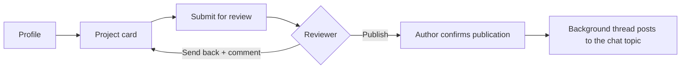

# Student Research Society Bot

[Русская версия](README.md)

A Telegram bot that helps students build teams for research projects. A member fills in a profile and creates a project card, then a moderator reviews it. Once the card is approved, the author confirms publication and the bot posts the project to a topic in the society's group chat.

Personal project, March–December 2025.

## Features

- **Member profile**: full name, study group, institute, date of birth, phone, email, social link. Every field can be edited later.
- **Project card**: title, description, required skills, team size, contacts. Projects can be edited or deleted.
- **Review.** The card is sent to a reviewer with inline buttons "Publish" and "Send back". When sending back, the reviewer writes a comment and the bot forwards it to the author. Reviewers are assigned round-robin, and a project can be resubmitted for review only once per 24 hours.
- **Publication.** After approval the bot asks the author to confirm publication. A background thread checks every 15 seconds for approved and confirmed projects and posts them to the chat topic.
- **Project ideas**: a separate flow for ideas without a team yet (title, idea, short description, field, source). Ideas go to a reviewer.
- **Q&A**: a placeholder section for now.

## Project flow



## Tech stack

- Python, [pyTelegramBotAPI](https://github.com/eternnoir/pyTelegramBotAPI): message handlers, `register_next_step_handler` for step-by-step dialogs, inline keyboards
- SQLite: tables for users, projects and ideas. WAL mode, `busy_timeout`, a shared `threading.Lock` for writes
- Schema migrations on startup: missing columns are added via `PRAGMA table_info` and `ALTER TABLE ... ADD COLUMN`
- A background `threading.Thread` for publishing

## Quick start

```bash
pip install -r requirements.txt
cp local_settings.example.py local_settings.py
# put the bot token, reviewer IDs and the publication chat into local_settings.py
python main.py
```

The `dbusers.db` database is created on the first run.

## Layout

| File | Contents |
|---|---|
| `main.py` | Menus, profile, projects, review, publication, background thread |
| `config.py` | Data models, SQLite connection, table creation |
| `local_settings.example.py` | Settings template: token, reviewers, publication chat |

## License

[MIT](LICENSE)

---

<sub>The code was written in March–December 2025 and published on GitHub in November 2026. Commit dates follow the dates of the original files; the README was added at publication.</sub>
