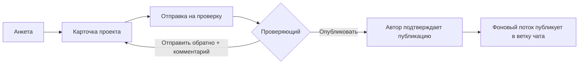

# Бот для студенческого научного общества

[English version](README.en.md)

Telegram-бот помогает студентам собирать команды в научные проекты. Участник заполняет анкету и создаёт карточку проекта, карточку проверяет модератор. После одобрения автор подтверждает публикацию, и бот сам выкладывает проект в ветку общего чата научного общества.

Личный проект, март–декабрь 2025.

## Возможности

- **Анкета участника**: ФИО, учебная группа, институт, дата рождения, телефон, почта, ссылка на соцсеть. Всё редактируется в разделе «Личные данные».
- **Карточка проекта**: название, описание, нужные компетенции, число участников, контакты. Проект можно изменить или удалить.
- **Проверка.** Карточка уходит проверяющему с inline-кнопками «Опубликовать» и «Отправить обратно». Во втором случае проверяющий пишет комментарий, и бот пересылает его автору. Проверяющие назначаются по кругу (round-robin). Повторно отправить проект на проверку можно не раньше чем через 24 часа.
- **Публикация.** После одобрения бот спрашивает автора, публиковать ли проект. Фоновый поток раз в 15 секунд находит одобренные и подтверждённые проекты и отправляет их в ветку чата.
- **Идеи проектов**: раздел «Добавить возможный проект» (название, суть, краткое описание, направление, источник). Идея уходит проверяющему.
- **Q&A**: раздел-заготовка, пока без наполнения.

## Как проходит проект



## Стек

- Python, [pyTelegramBotAPI](https://github.com/eternnoir/pyTelegramBotAPI): обработчики сообщений, `register_next_step_handler` для пошаговых диалогов, inline-кнопки
- SQLite: таблицы пользователей, проектов и идей. Режим WAL, `busy_timeout`, общая блокировка `threading.Lock` для записи
- Автомиграции при старте: недостающие колонки добавляются через `PRAGMA table_info` и `ALTER TABLE ... ADD COLUMN`
- Фоновый поток `threading.Thread` для публикации

## Запуск

```bash
pip install -r requirements.txt
cp local_settings.example.py local_settings.py
# впишите в local_settings.py токен бота, ID проверяющих и чата для публикации
python main.py
```

База `dbusers.db` создаётся при первом запуске.

## Структура

| Файл | Что внутри |
|---|---|
| `main.py` | Меню, анкета, проекты, проверка, публикация, фоновый поток |
| `config.py` | Модели данных, подключение к SQLite, создание таблиц |
| `local_settings.example.py` | Шаблон настроек: токен, проверяющие, чат для публикации |

## Лицензия

[MIT](LICENSE)
